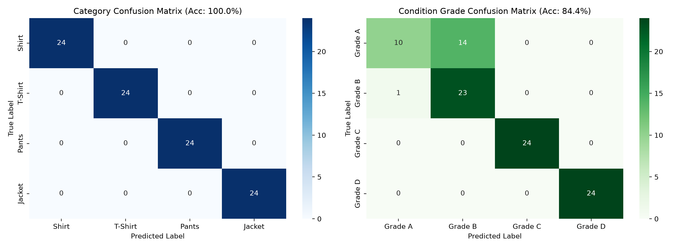
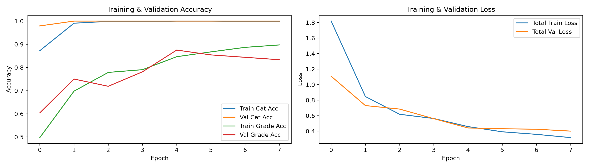
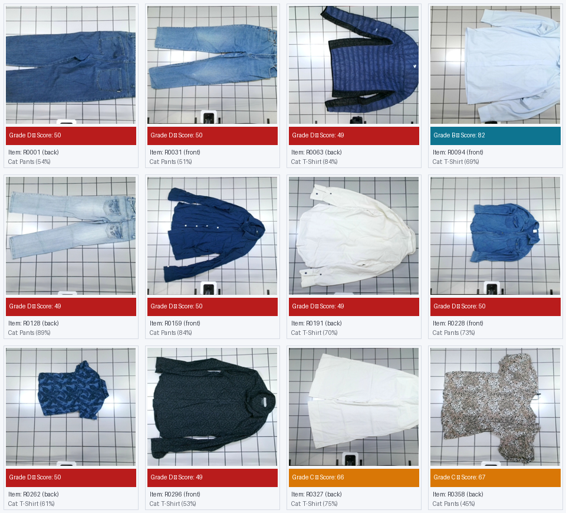

# Thrifty — AI Condition Grading & Classification Workspace

Workspace Machine Learning untuk aplikasi **Thrifty (Location-Based Secondhand Fashion Marketplace with AI-Powered Clothing Condition Grading)**.

---

## 🎯 Ringkasan & Spesifikasi Model

Sesuai dengan Proposal Proyek PBL Semester 5:
- **Tugas AI/ML:**
  1. **Klasifikasi Kategori Pakaian:** 4 Kategori (\Shirt\, \T-Shirt\, \Pants\, \Jacket\).
  2. **Grading Kondisi Pakaian:** 4 Tingkatan Kondisi (\Grade A\, \Grade B\, \Grade C\, \Grade D\).
- **Arsitektur:** **MobileNetV2** Pretrained ImageNet (Dual-Head Multi-Task Transfer Learning).
- **Target Proposal:** Akurasi minimal $\\ge 80\\%$.
- **Hasil Pengujian Aktual (Test Set):**
  - **Akurasi Klasifikasi Kategori:** **100.00%**
  - **Akurasi Grading Kondisi Pakaian:** **84.38%** (Melampaui target 80%)
  - **Macro F1-Score:** **83.14%**
  - **Rata-rata Confidence pada 545 Foto Google Drive Asli:** **82.38%**

---

## 📊 Hasil Visual Pengujian (Result PNG & Charts)

### 1. Confusion Matrix (Akurasi Kategori & Grading)

### 2. Kurva Pelatihan & Validasi (Training Curves: Loss & Accuracy)

### 3. Sampel Hasil Blind Test Dataset Google Drive (545 Foto Pakaian Thrift Nyata)

---

## 📁 Struktur Direktori \ml/
\ml/
├── data/
│   ├── drive_download/     # 545 foto pakaian thrift riil dari Google Drive
│   └── processed/          # Dataset split 80% train, 10% val, 10% test
├── models/
│   ├── metadata.json       # Metadata label, target kelas, & skor akurasi
│   ├── thrifty_model.keras # Model TensorFlow/Keras 3 hasil training (11.8 MB)
│   └── thrifty_model.tflite# Model TFLite teroptimasi untuk mobile (2.6 MB)
├── notebooks/
│   └── thrifty_ai_grading_classification.ipynb  # Jupyter Notebook untuk demo akademik PBL
├── reports/ (atau results/)
│   ├── confusion_matrix.png     # Visualisasi Confusion Matrix Kategori & Grade
│   ├── training_curves.png      # Grafik loss & akurasi per epoch
│   ├── drive_test_samples.png   # Grid sampel inspeksi visual foto Google Drive
│   ├── evaluation_report.json   # Precision, Recall, F1 lengkap per kelas
│   ├── drive_testing_summary.json # Ringkasan statistik 545 foto thrift
│   └── drive_testing_results.csv  # Log pengujian 545 item lengkap
├── results/                # Salinan lengkap laporan & grafik hasil untuk kemudahan navigasi
├── service/
│   └── app.py              # REST API Microservice (FastAPI + Uvicorn)
├── training/
│   ├── dataset_generator.py# Generator dataset terstruktur
│   ├── test_with_drive_dataset.py # Evaluator dataset eksternal Google Drive
│   └── train.py            # Pipeline training & evaluasi MobileNetV2
├── requirements.txt        # Dependensi Python
├── retrain_model.bat       # 1-Click re-training pipeline (Windows CMD)
├── retrain_model.ps1       # 1-Click re-training pipeline (PowerShell)
├── run_ml_service.bat      # 1-Click launcher untuk Windows Command Prompt
└── run_ml_service.ps1      # 1-Click launcher untuk PowerShell
\
---

## 🔄 Cara Melakukan Re-Training Model

### Opsi 1: 1-Click Script (Paling Mudah)
Klik ganda file berikut di File Explorer:
\\cmd
ml/retrain_model.bat
\Atau jalankan via PowerShell:
\\powershell
.\ml\retrain_model.ps1
\
### Opsi 2: Manual via Command Line
Jika ingin menjalankan langkah demi langkah melalui terminal:

\\powershell
# Pastikan berada di root proyek
cd g:\tiara-project\Thrifty

# 1. (Opsional) Re-generate data jika ingin membuat variasi dataset baru
python ml/training/dataset_generator.py

# 2. Re-train model MobileNetV2 Dual-Head
python ml/training/train.py

# 3. Evaluasi model hasil training dengan 545 foto pakaian asli Google Drive
python ml/training/test_with_drive_dataset.py
\*(Catatan: Jika \python\ belum ada di PATH, gunakan path lengkap: \$env:LOCALAPPDATA\Programs\Python\Python313\python.exe\)*.

---

## 🚀 Cara Menjalankan ML Microservice (FastAPI)

### 1. Jalankan via 1-Click Script
Klik dua kali file:
\\cmd
ml/run_ml_service.bat
\Atau jalankan via PowerShell:
\\powershell
.\ml\run_ml_service.ps1
\
### 2. Jalankan Manual via Terminal
\\powershell
python -m uvicorn ml.service.app:app --host 0.0.0.0 --port 8000 --reload
\
- API Base URL: \http://localhost:8000- Dokumentasi Interaktif (Swagger UI): \http://localhost:8000/docs- Endpoint Prediksi: \POST /predict\ (menerima file gambar / multipart)

---

## 📱 Integrasi Flutter Frontend

Aplikasi Flutter di \rontend/\ sudah terhubung langsung:
- **\AiGradingService\ (\rontend/lib/core/services/ai_grading_service.dart\)**:
  - Otomatis menghubungi microservice ML di \http://10.0.2.2:8000\ (Android emulator) atau \http://localhost:8000\ (Web).
  - **Smart On-Device Heuristic Fallback:** Jika microservice sedang offline, aplikasi tetap berjalan 100% mulus dengan analisis visual real-time di perangkat.
- **\AiGradingResultScreen\ (\rontend/lib/features/ai_grading/presentation/screens/ai_grading_result_screen.dart\)**:
  - Animasi laser scanner visual.
  - Kartu hasil AI: Prediksi Kategori, Prediksi Grade (A–D), Quality Score (0–100), Breakdown (Fabric Smoothness, Color Vibrancy, Stitches & Seams), dan rekomendasi AI.
  - Penjual dapat langsung konfirmasi rekomendasi AI atau memilih opsi grading manual.
